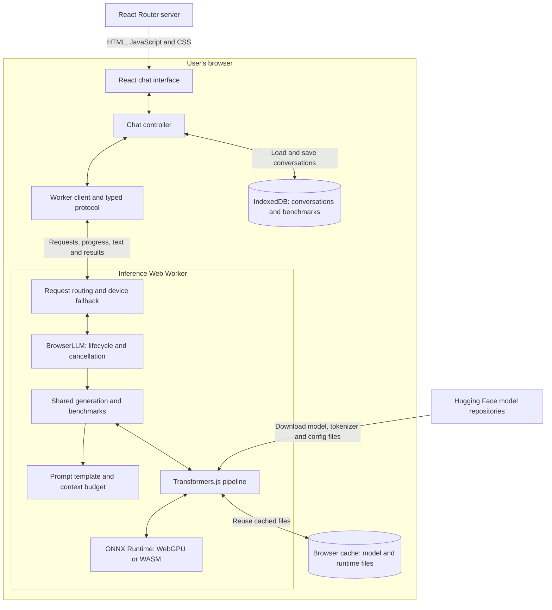

# Browser LLM

A browser-based chat app that runs language models on your device using Transformers.js and ONNX Runtime. Inference runs in a Web Worker, with WebGPU acceleration and a WASM fallback. The interface uses a compact, Minecraft-inspired design with a dark background and blue primary controls.

No inference API key or remote generation server is required. The server serves the application; the browser generates responses.

## Features

- Explicit model loading with an estimated model-file size before loading.
- Streaming responses and a Stop control.
- Multiple local conversations, stored in IndexedDB.
- Markdown assistant responses, including lists, tables and code blocks; raw HTML is disabled.
- Temperature and output-token controls.
- Tokenizer-based context budgeting that removes old turns while retaining system instructions.
- Per-response performance details saved alongside assistant messages.
- Responsive desktop and mobile layouts.

## Getting started

Install a current Node.js version supported by the project's Vite and React Router dependencies, plus Bun for dependency installation and tests.

```sh
bun install
npm run dev
```

Open **http://localhost:3000**. If that port is occupied, use the URL printed by Vite.

1. Select a model. The default is **Qwen3 0.6B (Optimized)**.
2. Click **Load model** and wait for initialization to finish.
3. Send a message. Use **Stop** to interrupt generation.
4. Open **Performance** beneath a response to inspect its measurements.

The first load downloads model files. Later loads can reuse cached files. Selecting another model requires loading it before sending messages; refreshing does not automatically load a model.

WebGPU requires browser and device support and a secure context, such as HTTPS or localhost. If WebGPU is unavailable or initialization fails, automatic loading attempts WASM on the CPU. CPU inference can be substantially slower.

## Available models

The model list and default are defined in [`config.ts`](app/feature/inference/config.ts).

| Model | Hugging Face repository | WebGPU precision | WASM precision |
| --- | --- | --- | --- |
| Qwen3 0.6B Optimized — default | `onnx-community/Qwen3-0.6B-ONNX-OPT` | Q4 | Q8 |
| Qwen2.5 0.5B Instruct | `onnx-community/Qwen2.5-0.5B-Instruct` | Q4 | Q8 |
| Qwen2.5-Coder 0.5B Instruct | `onnx-community/Qwen2.5-Coder-0.5B-Instruct` | Q8 | Q8 |
| Llama 3.2 1B Instruct | `onnx-community/Llama-3.2-1B-Instruct-ONNX` | Q4 | Q8 |

The size badge uses repository metadata for the chosen model and detected device. It includes required pipeline files, including external ONNX data files. It estimates file size, not runtime RAM/VRAM usage or remaining download bytes. WASM fallback can require a different download from the WebGPU estimate.

Qwen3 thinking mode is disabled through its chat template for direct answers. Model licenses remain those of their respective upstream repositories. This runtime loads compatible ONNX exports; GGUF files cannot be substituted directly.

## High-level system design



### Request flow

1. **Load:** the worker checks WebGPU support and creates a `BrowserLLM` instance. Its runtime configures caching and initializes the Transformers.js pipeline. Automatic mode attempts WASM if WebGPU initialization fails.
2. **Prepare:** the chat controller sends completed conversation history plus the new user message. The shared prompt path applies the model's chat template, counts tokens and removes the oldest turns until the input fits alongside the requested output budget.
3. **Generate:** `BrowserLLM` prevents overlapping generations. Transformers.js handles the token-generation loop while the shared generation module collects output and measurements.
4. **Stream:** token IDs feed the benchmark counters; decoded text chunks travel through the worker protocol to the UI. Assistant text renders as Markdown as it arrives.
5. **Finish:** completion, cancellation or failure returns its measurements. The chat controller saves the resulting conversation and nested response benchmark to IndexedDB. Streamed chunks update UI state without a database write for every chunk.

Stop requests interrupt generation through the engine. Model disposal awaits resource cleanup and is rejected while generation is active. The worker also rejects generation when the requested model differs from the loaded model.

### Custom code and package responsibilities

| Custom application code | Responsibility |
| --- | --- |
| `engine.ts` | Shared engine states, generation guards, cancellation and disposal |
| `inference.worker.ts` | Request routing, model matching and WebGPU/WASM loading fallback |
| `worker-client.ts`, `protocol.ts` | Worker communication, request IDs and error delivery |
| `prompt.ts`, `context-manager.ts` | Prompt preparation, token budgeting and history selection |
| `generation.ts`, `benchmark.ts` | Generation orchestration, streamed output and performance measurements |
| `model-registry.ts`, `use-model-size.ts` | Model inspection and size estimates using package metadata |
| `runtime.ts`, `cache-config.ts` | Pipeline initialization and cache settings |

**Transformers.js** supplies tokenization, model chat-template rendering, model loading, decoding, sampling, streaming primitives and stopping criteria. **ONNX Runtime** executes the neural-network computations using WebGPU or WASM. The app does not train models or implement GPU kernels. The custom `sampling.ts` utilities are not used by the active generation path.

Outside inference, React and React Router provide the application framework, `idb` wraps IndexedDB, and `react-markdown` with `remark-gfm` renders assistant Markdown.

## Performance measurements

Each attempted generation that reaches the shared generation module records:

- Model ID, device, precision, timestamp, temperature and output-token limit.
- Prompt-token and generated-token counts.
- Time to first generated token, total duration and tokens per second.
- Outcome: complete, cancelled or error.

Timing begins before prompt preparation and excludes model loading and UI rendering. Time to first token measures the first generated token-ID callback, which can occur before a visible word is streamed. Throughput is generated tokens divided by total duration, including prompt preparation. These are observations of individual requests, not controlled comparisons between models or devices.

## Storage, networking and offline behavior

| Data | Location |
| --- | --- |
| Conversations and per-response benchmarks | IndexedDB database `browser-llm`, store `conversations` |
| Model files and WASM runtime cache | Browser caching managed by Transformers.js |
| Loaded model sessions and working tensors | Browser memory while the runtime is active |

The application does not send chat prompts to a hosted inference API. Loading and inspecting models still makes network requests to Hugging Face, and the page can request external assets such as fonts. Local inference does not mean the entire site is network-free.

There is currently **no registered service worker**. Model caching alone does not guarantee that the site can reopen or refresh offline. Browser storage may also be cleared or evicted; saved chats and downloaded models are local to the browser profile and site origin.

## Project structure

```text
app/
  App.tsx                    Chat application layout
  feature/
    chat/
      components/            Messages, Markdown, controls and performance dialog
      use-chat.ts            Chat state and worker integration
      storage.ts             IndexedDB persistence
      types.ts               Conversation and message types
    inference/
      config.ts              Supported models and defaults
      worker-client.ts       Main-thread worker interface
      protocol.ts            Typed requests and responses
      inference.worker.ts    Worker request handling
      engine.ts              Shared BrowserLLM engine
      runtime.ts             Transformers.js pipeline setup
      generation.ts          Shared generation implementation
      prompt.ts              Model-specific prompt rendering
      context-manager.ts     Context selection and token budget
      tokenizer.ts           Tokenizer inspection helpers
      benchmark.ts           Per-response and repeated benchmark utilities
      model-registry.ts      File, cache and size inspection
      cache-config.ts        Transformers.js cache settings
```

## Checks and production build

```sh
npm run typecheck
bun test app/feature/inference app/feature/chat/components/assistant-markdown.test.tsx
npm run build
npm start
```

Tests cover prompt formatting and context trimming, streaming and cancellation metrics, benchmark calculations, and Markdown rendering. Generation tests use a simulated pipeline with a real tokenizer and streamer; they do not download models or verify GPU inference.

The production build outputs `build/client` and `build/server`. Deploy both with the Node server and required production dependencies. SSR serves the application shell; model inference remains in the user's browser. Serve production over HTTPS for WebGPU access where supported.

## Current limits

- One loaded model and one active generation per worker.
- The UI exposes temperature and maximum output tokens; top-K and top-P use engine defaults.
- Older history is dropped when the context budget is exceeded; it is not summarized.
- No app-level system prompt is automatically inserted; model templates can supply their own defaults.
- Small models can produce incorrect or incomplete answers. Markdown formatting does not validate their content.
- Download size is not a speed guarantee. Hardware, precision, prompt length and output length affect latency and memory use.
